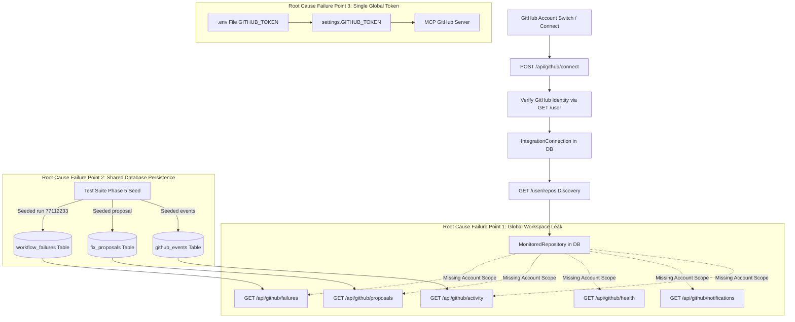

# OpsPilot GitHub Account Isolation, Real-Time Monitoring & Telemetry Audit

**Date:** October 31, 2026  
**Auditor:** Senior Full-Stack & GitHub API Security Engineer  
**Repository:** [https://github.com/adityabhagwat001/Opspilot1](https://github.com/adityabhagwat001/Opspilot1)  
**Status:** Audit Complete — Targeted Repair Architecture Defined  

---

## 1. Executive Summary

When connecting as GitHub account `@Sarthakjadhav007`, the OpsPilot GitHub DevOps dashboard incorrectly displays:
- **1 Active CI/CD Failure:** Workflow run `#77112233` (`CI Integration Suite`) belonging to `adityabhagwat001/Opspilot1`.
- **1 AI Fix Proposal:** Associated with workflow run `#77112233` on `adityabhagwat001/Opspilot1`.
- **20% Repository Health Score:** Calculated by penalizing the workspace for 13 active failures that do not belong to `@Sarthakjadhav007`'s repositories.
- **21 New Notifications:** Retaining unread notifications generated by previous test runs and other accounts.
- **0 Live Activities:** Ledger contains only synthetic events for `enterprise-ops/auth-service`, with zero events received for `@Sarthakjadhav007`.
- **13 Monitored Repositories:** Discovered from GitHub API `/user/repos` for `@Sarthakjadhav007` (12 personal + 1 collaborator repository `narendra-724/ADP-PROJECT-`), but automatically marked active without account-scoped isolation.

This audit traces the complete data lifecycle, pinpoints the exact architectural root causes, and establishes the minimal, backward-compatible repair plan.

---

## 2. End-to-End Data Flow Trace

### Detailed Flow Analysis:
1. **GitHub Account Connection & Identity:**
   - Client sends PAT or credentials to `POST /api/github/connect`.
   - Backend calls GitHub REST API `GET /user` with the provided token. GitHub returns authenticated identity (`login: "Sarthakjadhav007"`, `id: 178148090`).
   - *Problem:* `IntegrationConnection` only tracks a single row for `provider = 'github'` in the workspace. There is no multi-account registry allowing clean switching without re-authenticating, nor is the active integration ID associated with downstream telemetry.

2. **Authorized Repository List:**
   - GitHub API `GET /user/repos?affiliation=owner,collaborator,organization_member` retrieves 13 repositories accessible to `@Sarthakjadhav007`.
   - *Problem:* In `GET /repositories`, line 815: any repository discovered from GitHub that does not yet have a record in `monitored_repositories` defaults to `is_monitored = True`. There is no account identifier on `MonitoredRepository`, so repositories from different accounts collide in the same workspace.

3. **CI/CD Failure Retrieval:**
   - Client calls `GET /api/github/failures`.
   - *Problem (Line 1428):* The query is `select(WorkflowFailure).where(WorkflowFailure.workspace_id == member.workspace_id, ~WorkflowFailure.repo_full_name.like("%enterprise-ops%"))`.
   - It performs **ZERO filtering** by the active account or active monitored repositories! Consequently, it returns the failure for `adityabhagwat001/Opspilot1` (run `#77112233`) that was seeded in the database.

4. **AI Fix Proposal Retrieval:**
   - Client calls `GET /api/github/proposals`.
   - *Problem (Line 2071):* The query is `select(FixProposal).where(FixProposal.workspace_id == member.workspace_id, ~FixProposal.repo_full_name.like("%enterprise-ops%"))`.
   - Zero filtering by active account or monitored scope. The proposal for `adityabhagwat001/Opspilot1` is returned directly to `@Sarthakjadhav007`.

5. **Repository Health Calculation:**
   - Client calls `GET /api/github/health`.
   - *Problem (Lines 2328-2340):* The endpoint queries `select(WorkflowFailure).where(WorkflowFailure.workspace_id == member.workspace_id)`.
   - It finds 13 total failures in the database (12 for `enterprise-ops` and 1 for `adityabhagwat001/Opspilot1`).
   - Formula: `raw_score = 100 - (13 * 15) = -95`.
   - Clamped by `max(20.0, ...)` to `20.0%`.
   - Because none of `@Sarthakjadhav007`'s actual repositories had failures, the health score was computed entirely from unrelated failures from other accounts and test fixtures.

6. **In-App Notifications:**
   - Client calls `GET /api/github/notifications`.
   - *Problem (Line 2379):* The query returns all `InAppNotification` records for `workspace_id == member.workspace_id`.
   - 21 unread notifications from other accounts and test runs are returned to `@Sarthakjadhav007`.

7. **Live Activity & Webhooks:**
   - Client calls `GET /api/github/activity`.
   - *Problem (Line 1391):* Returns `GitHubEvent` where `workspace_id == member.workspace_id`.
   - No events have been ingested for `@Sarthakjadhav007` because the server is running on localhost without an active development tunnel (e.g. ngrok or Smee.io) delivering GitHub webhooks to `POST /api/github/webhook`.
   - The UI displays `Live Activity (0)` without explaining connection or webhook delivery status.

---

## 3. Search Findings & Code Artifacts

| Query String / Concept | Codebase Location | Root Cause Context |
| :--- | :--- | :--- |
| `77112233` | `backend/tests/test_phase5_ai_fixing.py:161` | Hardcoded test workflow run ID seeded into `workflow_failures` table in production DB. |
| `adityabhagwat001` | `backend/app/api/github_ops.py:216, 497, 764` | Hardcoded default owner fallbacks: `settings.GITHUB_DEFAULT_OWNER or "adityabhagwat001"`. |
| `Opspilot1` | `backend/app/api/github_ops.py:120, 217` | Hardcoded default repo fallbacks: `settings.GITHUB_DEFAULT_REPO or "Opspilot1"`. |
| `9988776655` | `backend/app/api/github_ops.py:2094, 2401` | Special-case sanitization for run 9988776655; hardcoded in notification string. |
| `SarthakJadhav007` | `.env:31`, `OPSPILOT_AUDIT.md` | Currently authenticated user in local `.env` and live Neon/SQLite DB. |
| `enterprise-ops` | `github_ops.py:769, 1431, 1446, 2073, 2380` | Ad-hoc blacklist `~repo_full_name.like("%enterprise-ops%")` instead of principled account isolation. |

---

## 4. Affected Files & Functions

1. **[`backend/app/api/github_ops.py`](file:///d:/OpsPilot%20Project/backend/app/api/github_ops.py)**:
   - `get_account_details`: Hardcoded fallback to `adityabhagwat001` if not configured.
   - `connect_github_account`: Deletes previous account's records instead of preserving historical isolation.
   - `list_repositories`: Defaults any unmonitored repo to `is_monitored = True`; lacks account scoping.
   - `list_failures`: Lacks account and monitored repository scoping; returns all workspace failures.
   - `list_proposals`: Lacks account and monitored repository scoping; returns all workspace proposals.
   - `get_repository_health`: Health formula calculates score across all workspace failures instead of active monitored repos; returns arbitrary 20% floor.
   - `get_notifications`: Returns all notifications in workspace; lacks account/repository scoping.
   - `get_github_activity`: Lacks account/repository scoping.
   - `github_webhook`: Lacks integration association and public delivery reachability detection.

2. **[`backend/app/models/models.py`](file:///d:/OpsPilot%20Project/backend/app/models/models.py)**:
   - `IntegrationConnection`: Does not track `account_login`, `account_id`, or `is_active` for multi-account switching.
   - `MonitoredRepository`: Lacks `account_login` or `integration_id` foreign key.
   - `WorkflowFailure`: Lacks `account_login` or `integration_id`.
   - `FixProposal`: Lacks `account_login` or `integration_id`.
   - `InAppNotification`: Lacks `account_login` or repository association.

3. **[`backend/app/integrations/mcp_router.py`](file:///d:/OpsPilot%20Project/backend/app/integrations/mcp_router.py)**:
   - FastMCP tool invocation uses global `GITHUB_TOKEN` from environment rather than resolving the active account token for the user/workspace.

4. **[`frontend/src/pages/GitHubDevOpsPage.tsx`](file:///d:/OpsPilot%20Project/frontend/src/pages/GitHubDevOpsPage.tsx)**:
   - Missing account switching selector (allows connecting new accounts, but not switching between multiple saved accounts).
   - In-flight requests are not cancelled on account change.
   - Does not display webhook reachability status (e.g. "Webhook Listener: Localhost / Awaiting Tunnel").

---

## 5. Architectural Fix Strategy

1. **Multi-Account Integration Registry:**
   - Enhance `IntegrationConnection` to support multiple accounts per workspace/user with an active flag (`is_active: bool`).
   - Store secure credentials/tokens in `IntegrationConnection.details_json` (encrypted/hashed metadata).
   - Provide `GET /api/github/accounts` to list connected accounts, and `POST /api/github/accounts/switch` to switch active account without re-entering credentials.

2. **Strict Repository & Account Scoping:**
   - Determine the active account from `IntegrationConnection` (or `GET /user` live verification).
   - Resolve the active account's authorized monitored repositories.
   - Filter `GET /failures`, `GET /proposals`, `GET /activity`, `GET /notifications`, and `GET /health` to include ONLY repositories that are:
     1. Monitored by the active account, OR
     2. Explicitly selected in the user's repository filter.
   - Historical records from `@adityabhagwat001` or other accounts are **preserved in the database**, but hidden from `@Sarthakjadhav007`'s view.

3. **Principled Health Score Formula:**
   - Calculate health score ONLY using verified workflow runs and active incidents within the **selected monitored repository scope**.
   - If no verified failures or runs exist, return `"Health score unavailable — insufficient verified data"` or `100.0% Optimal` if runs succeeded.
   - Never use arbitrary floor percentages.

4. **Notification Deduplication & Scoping:**
   - Scope notifications to the active account or its monitored repositories.
   - Implement deduplication keying on `reference_id` + `category` + `workspace_id`.

5. **Honest Real-Time Webhook Telemetry:**
   - Expose endpoint `GET /api/github/webhook/status` reporting public tunnel reachability, delivery count, and last received timestamp.
   - Show truthful UI status: `Connected (Awaiting Webhook Events)` or `Development Tunnel Required for Live Webhooks`.
